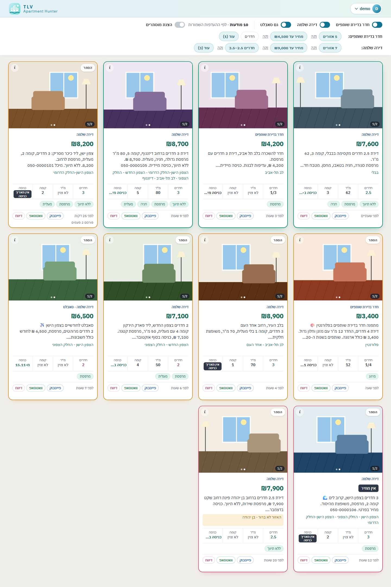
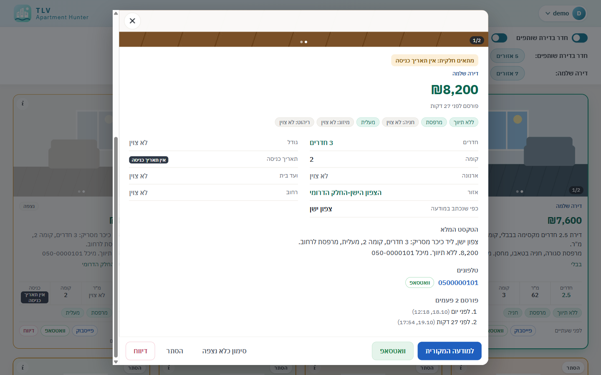
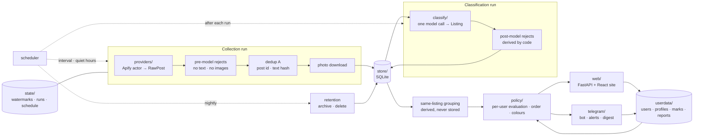
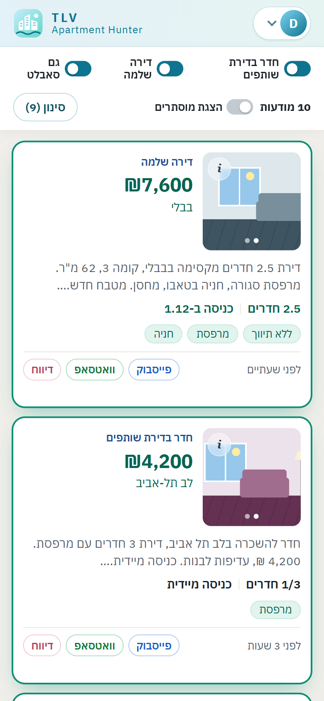
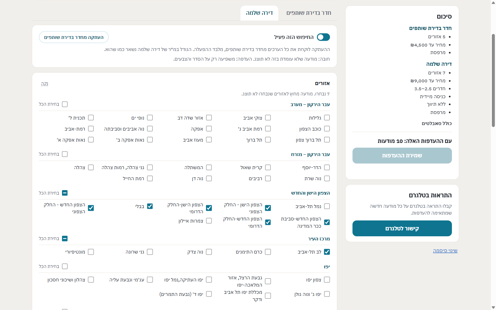

# TLV Apartment Hunter

**Tel Aviv rental posts from public Facebook groups, collected, classified once by a language model, and ranked
for each person who uses it.**

[](https://github.com/ron45700/TAH-tlv_apartment_hunter/actions/workflows/docker.yml)




<sub>All screenshots are of the real site running over a synthetic demo store: invented posts, fake phone numbers,
drawn photos. The site's interface is in Hebrew and right-to-left.</sub>

---

## The problem

Rentals in Tel Aviv are posted in several busy Facebook groups. The posts are many, and the same flat is posted again
and again (sometimes reworded, sometimes in the same group). Every post is free text with its own way of writing the
price, the rooms and the entry date, and a good flat is gone within hours. Finding the few posts that fit means
scanning every group, several times a day.

TLV Apartment Hunter does the scanning. It collects the posts, reads each one once, and shows every user the posts
that fit them first, with an alert on Telegram when a new one arrives.

It serves a small, private group of users: access is by invitation from the admin, inside a private network.

## Features

- **Collection from public groups.** A scheduled job fetches the newest posts from a shared list of public groups
  through an Apify actor, with a per-group watermark so that a window is never skipped. Photos are downloaded at fetch
  time, since Facebook's image links expire.
- **One-time LLM extraction, original text always shown.** Each post is sent once to an OpenAI model with structured
  output and comes back as fields: price, rooms, floor, size, entry date, broker, balcony, parking, the area (one of
  Tel Aviv's 71 municipal neighbourhoods), and more. Every field is *written*, *not written* or *unclear*, and "not
  written" is kept as information, not treated as a failure. The card always shows the poster's own text, unchanged.
- **Same-listing grouping.** Exact reposts are caught before the model. A flat reposted with new words is tied to its
  earlier post after classification (a shared phone or an identical photo, plus matching price, rooms and area), so it
  becomes one card with a "posted N times" log instead of a new card and a second alert.
- **Personal profiles with two tiers.** Each user saves a "room in a shared flat" search and an "empty apartment"
  search, each on or off, with its own values. Area and price are always *critical*: a post that fails them is not
  shown. Rooms, floor, size, broker, parking, balcony and the entry date are *preferences* by default, and each can be
  made critical. A "show sublets too" switch and a "women only" filter complete the profile.
- **Card colours and glow.** Every field on a card is coloured for the person looking at it: green when it is known
  and good, red when it misses their preference, orange when the post is unclear, grey when it is not stated. The card
  glows green when it meets every preference, orange when it meets the critical conditions only, and red when
  something critical (the price, the area) is missing or unclear. The order follows the same tiers.
- **Viewed and hidden marks.** Opening a card marks it viewed for that user; viewed cards fade and move below the
  unviewed ones. A user can hide a post from their own list and bring it back.
- **"Lied" flags and wrong-classification reports.** Any signed-in user can flag a post that is not what it claims, or
  report fields the model got wrong. Either takes the post out of everyone's list until the admin decides. The admin
  corrects a field by hand (the correction then overrides the model's answer everywhere, and the card says so),
  restores the post, or leaves it out.
- **Telegram linking and alerts.** A user links Telegram with a one-time code from the site. When a new post passes
  their critical conditions and has a price and a known location, the bot sends it with its photo and key fields, and
  buttons to open it on the site, on Facebook or in WhatsApp, or to report it. A post is alerted to a user at most
  once; reposts never alert. The bot's menu button opens the site inside Telegram.
- **Admin pages and schedule.** One admin issues sign-up keys, manages users, and reviews the rejected and pending
  posts, the flags, the reports and the corrections. The schedule page sets the run interval and the quiet hours,
  starts a run now, and lists the last runs with their real cost. The bot sends the admin a daily digest, and an alert
  when collection fails or a group goes silent.
- **Retention.** A post is archived 25 days after it was last published (its photos deleted) and deleted at 40 days.
  Flagged and reported posts are kept whole, and reports and corrections are never deleted.

<p align="center">
  
</p>

## How it works



The code is split along a few seams, each with a small contract: `providers/` is the only code that knows where a
post came from; `classify/` turns one post into one `Listing` and writes nothing; `store/` is the repository for
posts, their lifecycle and their classification; `state/` holds the watermarks, the run records and the schedule;
`userdata/` holds everything users write through the site; `policy/` evaluates a classified post against one user's
profile and is pure; `notify/` and `telegram/` send. The job commands, the site and the bot are wiring over these.

## Design principles

- **Extraction is shared, ranking is personal.** What a post says is classified once, for everyone. How good it is
  for a given person is a calculation over the stored fields, never a second model call and never a per-user prompt.
  What one user's profile makes of a post is never written onto the post.
- **The model classifies only.** It returns facts in a fixed schema. It never summarizes, never rewrites and never
  adds text of its own; the rejection reasons are derived from its answer by code.
- **The original post is what the card shows.** The model receives a copy; classification never changes the stored
  post, and a test pins that.
- **No account and no login, with any source,** and never a user's cookie or credential. Public groups only.
- **Real scraped data never enters git.** Posts contain real people's phone numbers; `data/` is ignored, and the
  tests that read captured provider responses read them in place and fail, rather than skip, when they are missing.
- **No personal identifiers in outgoing requests.** No email, name or phone of any user in a header, URL or body;
  the only exception is a Telegram chat id, sent to Telegram alone.
- **The watermark advances only on success.** A failed run moves nothing, so the next run covers the gap.
- **Compare-and-set writers.** The collection run, the site, the bot and the maintenance jobs all write a post's
  lifecycle record only if it is still the one they read; a conflict is merged or retried, never overwritten.
- **Capped paid commands.** Every command that costs money runs under an explicit cap: a charge cap on each Apify
  run, and a dollar cap (`--cap`) on every command that calls the model.
- **Tests never hit the network.** A socket guard in the test suite raises on any connection attempt.
- **Outside contracts are pinned by captured responses.** Every provider adapter is tested against real responses
  captured from the service, so a change in an outside API shows up as a failing test.

## Tech stack

| Layer | Choice |
|---|---|
| Language and tooling | Python 3.12, [uv](https://docs.astral.sh/uv/), Ruff, pytest |
| Data models | Pydantic |
| Storage | SQLite (one file: posts, state and user data, each behind its own interface) |
| Classification | OpenAI API with structured output |
| Collection | An Apify actor for public Facebook groups |
| Site | FastAPI and uvicorn serving a React + TypeScript app built with Vite (hand-written CSS, Vitest) |
| Accounts | Username and password (Argon2id), one-time sign-up keys, an HTTP-only session cookie |
| Bot | Telegram Bot API through a small client of its own (long polling, no public endpoint) |
| Runtime | A Docker image (two-stage build) and Docker Compose; GitHub Actions publishes the image to ghcr.io |
| Access | Tailscale Serve: HTTPS inside a private tailnet only |

```
tlv_hunter/                  the Python package
  providers/                 fetching posts (one adapter per provider)
  classify/                  the model call and its instructions
  store/ state/ userdata/    the three storage interfaces over one SQLite file
  policy/                    per-user evaluation, order and colours (pure)
  dedup/ premodel/ postmodel/  duplicates and rejection rules
  web/                       the FastAPI site and its API
  telegram/ notify/          the bot, alerts, the digest
  jobs/                      the command-line jobs (collection, classification, retention, scheduler, ...)
frontend/                    the React + TypeScript site
reference/                   Tel Aviv's 71 areas, their grouping, known places
config/                      collection settings (the group list, limits, the charge cap)
tests/                       the test suite
docs/                        the design documents
Dockerfile  compose.yaml  .github/workflows/docker.yml
```

## Getting started

### Prerequisites

- Python 3.12 and [uv](https://docs.astral.sh/uv/)
- Node.js (CI uses Node 24) for the front end
- Docker with Compose
- Accounts for what the system talks to: an **Apify** account (collection), an **OpenAI** API key (classification),
  a **Telegram bot** from BotFather (alerts), and **Tailscale** to serve the site privately

### Environment variables

Set them in a `.env` file next to `compose.yaml` (never committed). Names only here; each service receives only the
ones it needs.

| Variable | Read by |
|---|---|
| `APIFY_TOKEN` | the collection run, and the job that settles each run's real cost |
| `OPENAI_API_KEY` | the commands that call the model |
| `TELEGRAM_BOT_TOKEN` | the bot service only |
| `SITE_URL` | the bot (the address its buttons open) |
| `RUN_INTERVAL_MINUTES`, `QUIET_FROM`, `QUIET_UNTIL` | the scheduler, for the first schedule only; after that the admin sets it on the site |
| `RETENTION_APPLY` | the scheduler: retention runs as a dry run unless this is `yes` |

The site itself reads no key.

### Install, test, build

```bash
uv sync                                  # Python dependencies
uv run pytest -m "not raw_fixtures"      # the tests a clean clone can run (as CI does)
uv run ruff check . && uv run ruff format --check .

cd frontend
npm ci                                   # exactly as locked
npm test                                 # Vitest
npm run build                            # type-check, then build into frontend/dist
```

Tests marked `raw_fixtures` read captured provider responses from `data/raw/`, which is never committed; without it
they fail by design.

### Run it with Docker

The group list and the collection limits are in `config/collection.yaml`. Every command that opens the store runs in
a container, over the store in a Docker volume.

```bash
docker compose build                     # the image
docker compose run --rm jobs python -m tlv_hunter.jobs.run_once --bootstrap --max-posts 30   # PAID: the first run, creates the store
docker compose run --rm jobs python -m tlv_hunter.jobs.classify_pending --cap 0.05            # PAID: classify what is pending
docker compose run --rm jobs python -m tlv_hunter.jobs.create_admin                           # the one admin account
docker compose up -d site                # the site on http://127.0.0.1:8000/
docker compose stop site
```

Never `docker compose down -v`: `-v` deletes the volume, and the store with it.

**Paid commands** are the collection run (`run_once`, Apify) and every command that calls the model
(`classify_pending`, `regression_run`, `reclassify --run`). Each runs under a cap: the Apify charge cap in
`config/collection.yaml`, and `--cap` in dollars for the model. Everything else (the site, the bot, backups,
retention, the reports) is free.

### Deployment overview

- On every push to `main`, the GitHub Action runs the checks and publishes the image to `ghcr.io/<account>/<repo>`,
  tagged `latest` and by commit.
- A home server runs a Compose stack that pulls that image: the **site**, the **bot**, the **scheduler** (collection,
  classification, cost settlement, and retention once a night inside the quiet hours), and a **Tailscale** container
  that publishes the site with Tailscale Serve, HTTPS and tailnet-only. Friends reach it through Tailscale sharing.
- `export_backup` takes a consistent dated copy of the store before each update; the newest copies are kept.
- An update never touches the store's folder, and the store, `.env` and keys never enter git or the image.

[`docs/DEPLOY.md`](docs/DEPLOY.md) has the details.

<p align="center">
  
  &nbsp;&nbsp;
  
</p>

<!--
  Placeholder for a fifth image: a Telegram alert.
  Capture one alert message from the bot on a phone (the photo, the lines and the buttons under it). Crop to the
  message only; blur or cover any real post text, phone number, name, link and chat name, or capture a test alert over
  invented data. Save it as docs/images/telegram-alert.png (under ~300 KB) and replace this comment with:
  <p align="center"></p>
-->

## Coming next

- **Yad2 as a second source.** Tel Aviv-Yafo listings from Yad2, collected by a browser on the server beside the
  Facebook groups, classified by the same model with Yad2's own form fields taken as they are, and shown with their
  source on each card.

## Possible extensions

Ideas for later:

- **Editing the group list from the dashboard**, with the number of posts fetched per group
- **Failover to a second Apify actor** when the first one fails
- **Favourites** on a card
- **Perceptual photo hashing**, to tie reworded reposts whose photos were re-encoded
- **A street table** to help place posts that give only a street

## Data and responsible use

The system reads **public groups only**, with no account, login or user's cookies. It is a private, non-commercial
service for a small group of users searching together. Real posts, which contain real people's phone numbers, are kept
out of this repository: the store, captured responses and exports live only on the machines that run it. The site is
served only inside a private tailnet, and an account needs a one-time key from the admin.

## Further reading

The design is documented in [`docs/`](docs/): [`BASELINE.md`](docs/BASELINE.md) describes what the system is and how
it is built, and [`SCHEMA.md`](docs/SCHEMA.md) is the source of truth for every field and filter rule.
